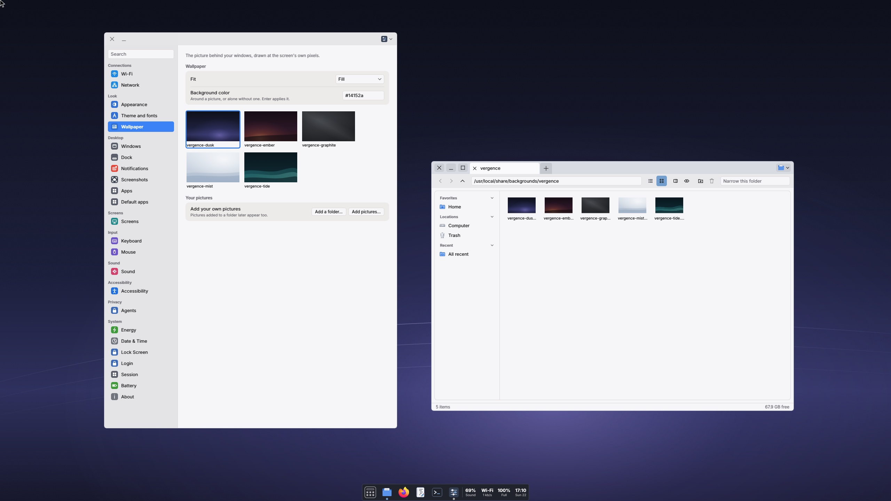
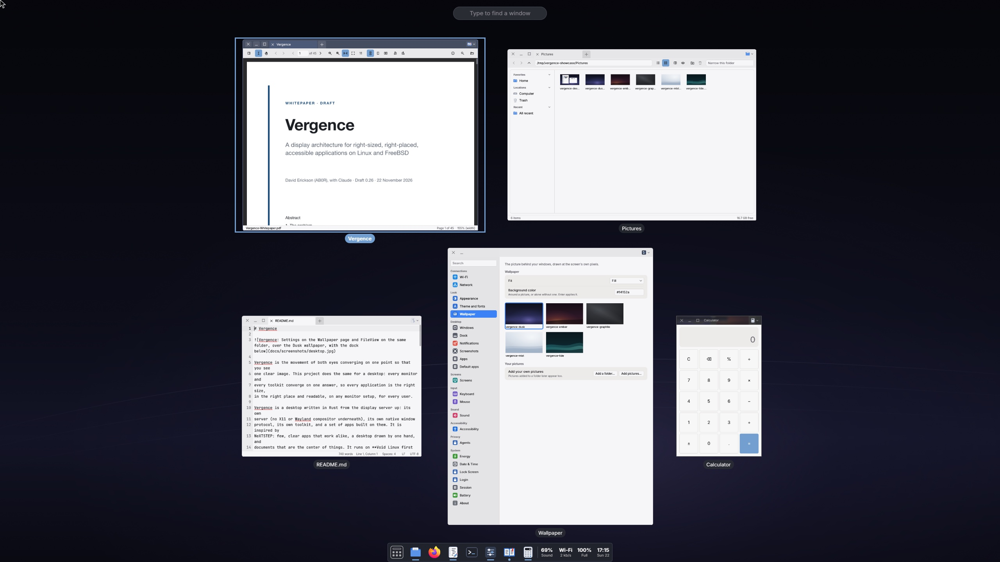
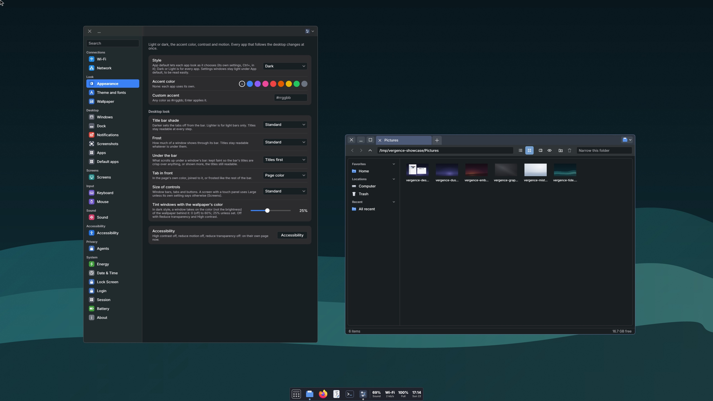
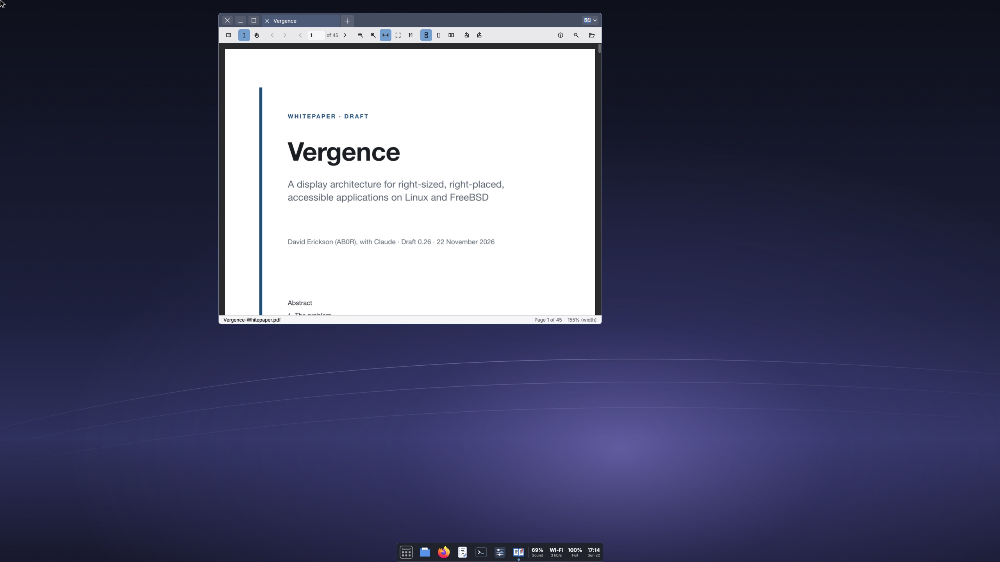
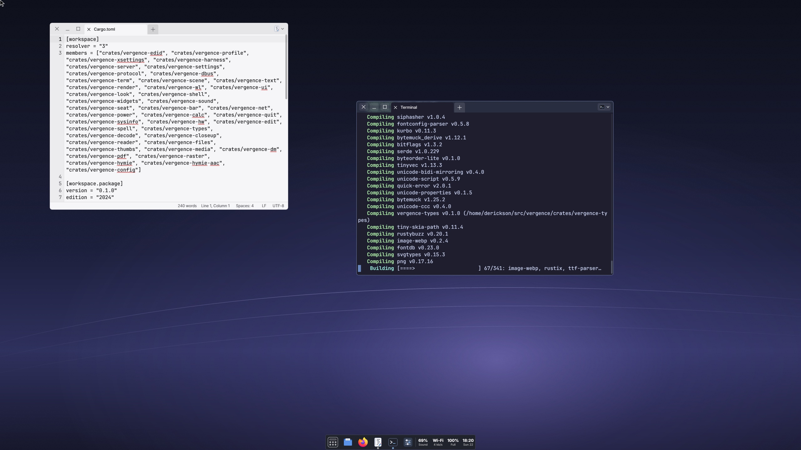

# Vergence

Vergence is the movement of both eyes converging on one point so that you see
one clear image. This project does the same for a desktop: every monitor and
every toolkit converge on one answer, so every application is the right size,
in the right place and readable, on any monitor setup, for every user.

Vergence is a desktop written in Rust from the display server up: its own
server (no X11 or Wayland compositor underneath), its own native window
protocol, its own toolkit, and a set of apps built on them. It is inspired by
NeXTSTEP: few, clear apps that work alike, a desktop drawn by one hand, and
documents that are the center of things. It is developed for the **Void Linux
and FreeBSD** platforms.

## What it is

- **A display server** that draws every screen at its own scale from the
  windows' display lists, so text is sharp on any monitor, and that keeps
  each window's place for each monitor setup. Wayland programs (Firefox,
  GTK, Qt) run in it too; X11 programs can, if you switch them on.
- **One look, drawn by the server**: title bars with tabs, frost, light and
  dark styles with contrast floors, a dock with live tiles, a launcher, an
  overview, snapping, Alt+Tab.
- **Apps on its own toolkit**: FileView (the file manager, with a Quick
  Look-style preview), Edit, Reader (PDF on its own engine), Close-Up
  (pictures), Terminal, Settings, Calculator, Hardware, Force Quit and
  Screenshot.
- **A login and lock screen** of its own (vdm).
- **Agents as first-class users**: every widget publishes what it means, and
  an AI agent (or a screen reader) can act on an app by name, with the
  user's permission per agent and per app.
- **Untrusted files in confined helpers**: pictures, PDFs and sound are
  parsed in processes that can do nothing else (Capsicum on FreeBSD, seccomp
  on Linux).

STATUS.md says what is built and what comes next.

## Screenshots

<table>
<tr>
<td> The overview (Super+Tab): every window at a glance.</td>
<td> Dark style: windows take on the wallpaper's color.</td>
</tr>
<tr>
<td> Reader, on its own PDF engine: the story of Vergence's first 17 days.</td>
<td> Edit beside Terminal, building Vergence itself.</td>
</tr>
</table>

All made by `tools/lab/showcase.sh` in fresh sessions with the shipped
defaults.

## Try it

**On Void Linux (glibc)**, Vergence is one xbps package. Until it has a
repository of its own, build it with Void's own tools:

    git clone --depth 1 https://github.com/void-linux/void-packages
    cd void-packages && ./xbps-src binary-bootstrap
    git clone https://github.com/gsa700/vergence /tmp/vergence
    cp -r /tmp/vergence/packaging/void/srcpkgs/vergence srcpkgs/
    ./xbps-src pkg vergence
    sudo xbps-install --repository=hostdir/binpkgs vergence
    sudo vergence-setup     # once: enables seatd, vdm and the rest, asking first

Then log out and back in, or reboot, and choose Vergence at the login screen.

**From the source** (development, or FreeBSD, whose port comes later):

    cargo build --release
    sudo tools/install.sh
    vergence            # from a text console, or choose Vergence at the login screen

CONTRIBUTING.md has the details: what to install first, running a session
from the checkout or headless, the tests, and removing Vergence.

## Read on

- [ARCHITECTURE.md](ARCHITECTURE.md): the map of the code, crate by crate.
- [CONTRIBUTING.md](CONTRIBUTING.md): building, running, testing, and the
  rules the code keeps.
- [STATUS.md](STATUS.md): where things stand.
- [docs/Vergence-Whitepaper.md](docs/Vergence-Whitepaper.md): the design
  (a PDF beside it).
- [docs/Vergence-17-Days.pdf](docs/Vergence-17-Days.pdf): how Vergence went
  from an idea to its first release in 17 days.
- docs/<area>-milestone-N.md: each piece of work, planned and built
  (docs/milestone-1.md to -4.md, with no area, are phase 1's, the retired X11
  daemon; STATUS.md links the current ones).

## License

Copyright 2026 David Erickson.

Vergence is licensed under either of

- the Apache License, Version 2.0 ([LICENSE-APACHE](LICENSE-APACHE)), or
- the GNU General Public License, version 2 or (at your option) any later
  version ([LICENSE-GPL](LICENSE-GPL)),

at your option (SPDX: `Apache-2.0 OR GPL-2.0-or-later`). One part is
GPL-2.0-or-later only: crates/vergence-hymie-aac, the AAC decoder ported from
FAAD2, which runs as a helper program of its own (libexec/vergence/
vergence-hymie-aac) and is linked into nothing else. Apache-2.0 for
permissive use, as in the Rust and BSD worlds, with its patent grant; the GPL
for GPL projects, including GPLv2 ones, which cannot take Apache-2.0 code.
Both come with no warranty and no liability for the authors.

Unless you say otherwise, a contribution you submit is licensed the same way,
with no additional terms.

The code Vergence is built with keeps its own licenses: see
[THIRD-PARTY-NOTICES.md](THIRD-PARTY-NOTICES.md), generated by
`tools/notices.py` (run it after changing dependencies). Code copied in keeps
its license file beside it (crates/vergence-server/LICENSE-smithay.txt,
third_party/drm-rs/LICENSE).
